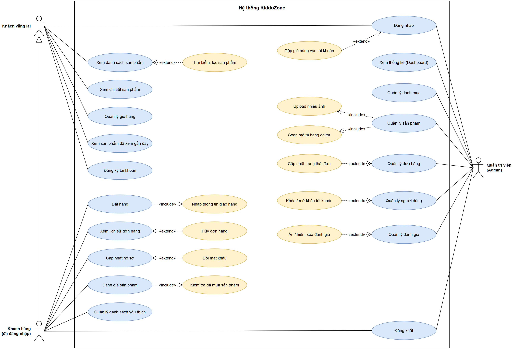
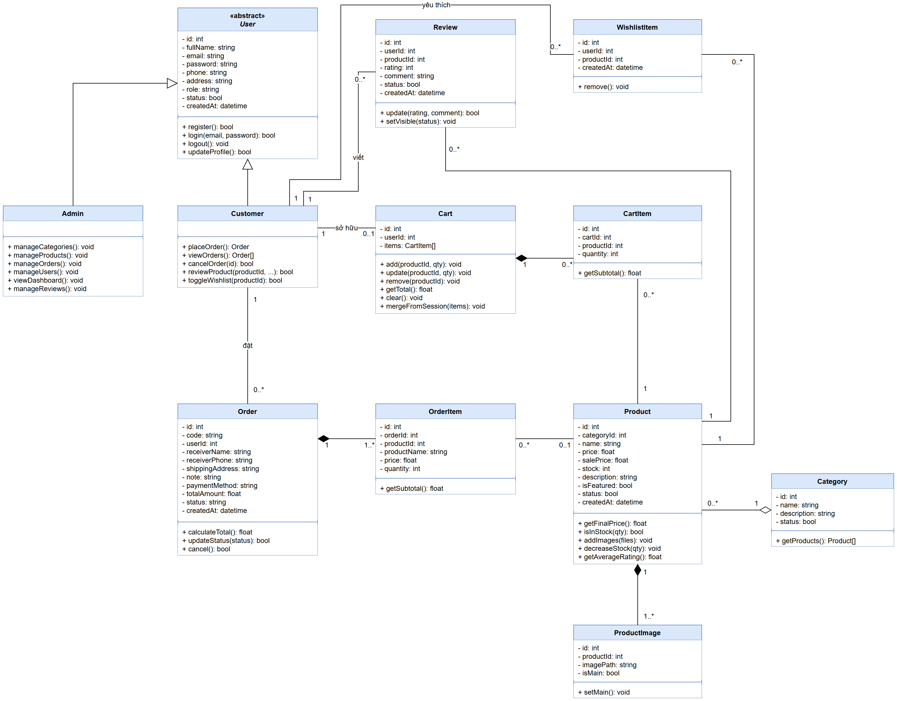
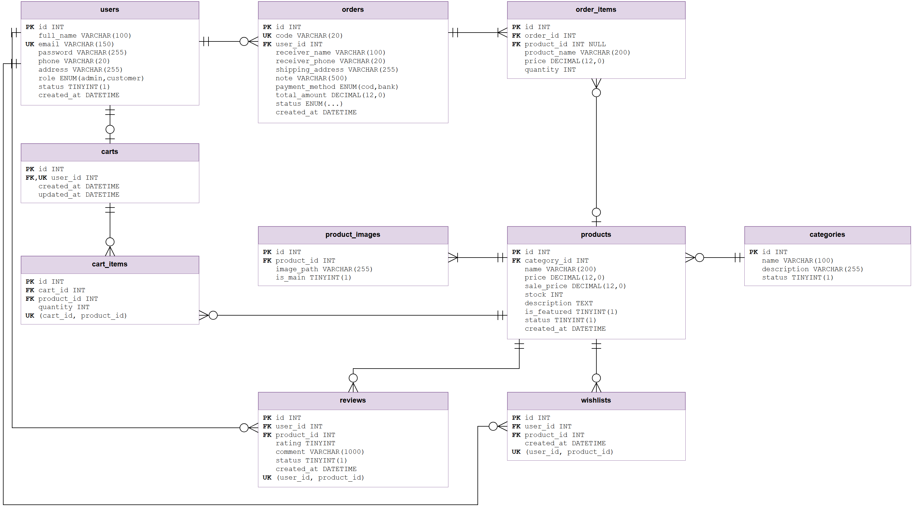
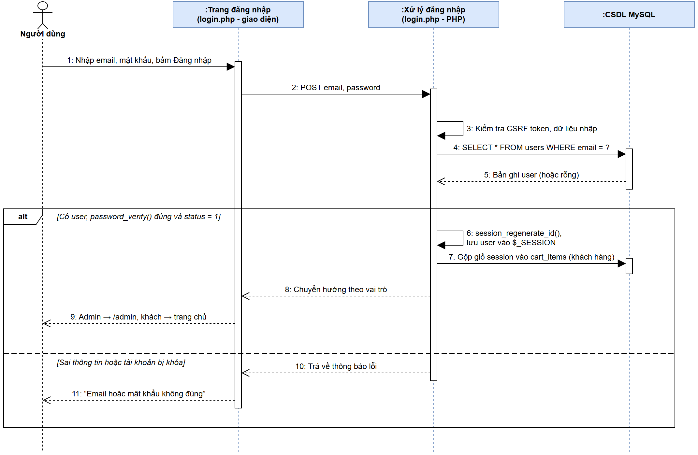
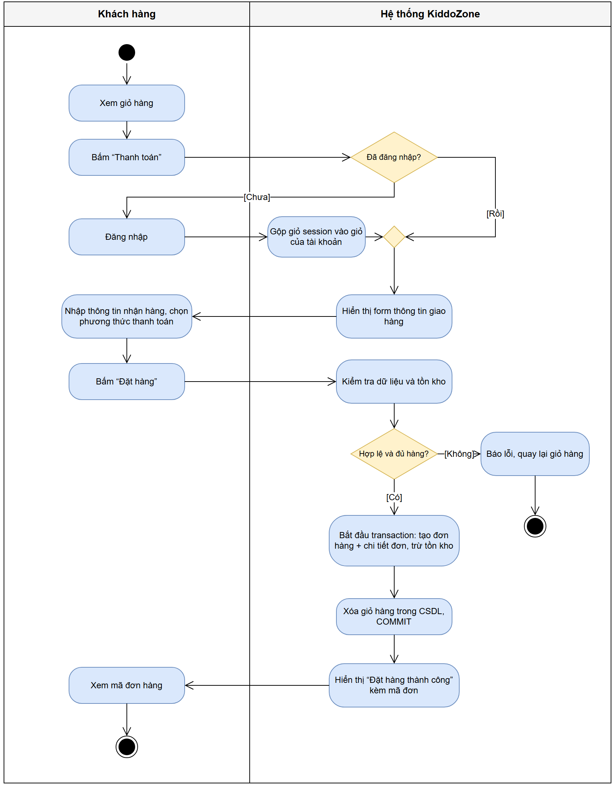
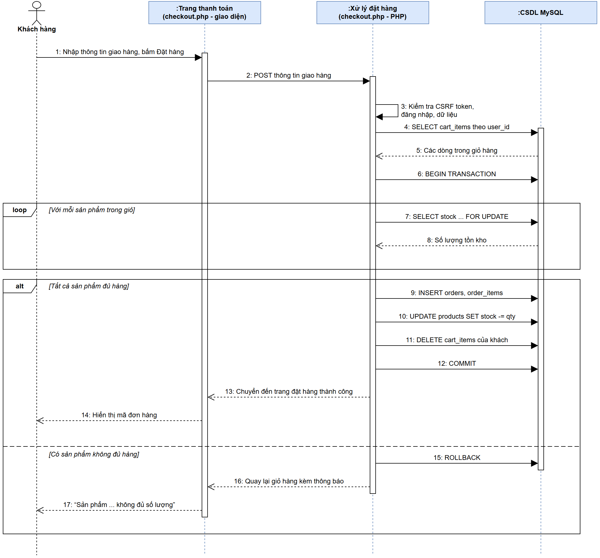

# Tài liệu thiết kế hệ thống Website bán hàng KiddoZone

Môn: Lập trình Web. Chủ đề: Website bán hàng cơ bản (đồ chơi trẻ em).

Công nghệ: PHP 8 + MySQL (backend), HTML5 + Bootstrap 5 + JavaScript thuần (frontend).

Nhóm gồm 5 thành viên: Đỗ Hùng Mạnh (trưởng nhóm), Phạm Minh Quân, Lê Thanh, Trần Hoàng Duy, Hoàng Liêm.

## 1. Tổng quan

### 1.1. Mục tiêu

KiddoZone là website bán đồ chơi trẻ em (đồ chơi giáo dục, lắp ráp, búp bê và thú bông, xe và mô hình, đồ chơi vận động), gồm hai phần:

- **Trang người dùng:** xem, tìm kiếm, lọc sản phẩm, xem lại sản phẩm đã xem gần đây, quản lý giỏ hàng, đặt hàng, xem lịch sử đơn hàng, đánh giá sản phẩm đã mua, lưu sản phẩm yêu thích.
- **Trang quản trị (Admin):** quản lý danh mục, sản phẩm, đơn hàng, người dùng, đánh giá và xem thống kê.

**Phạm vi:** thanh toán chỉ có COD và chuyển khoản (ghi nhận thủ công). Website không làm cổng thanh toán online, gửi email và mã giảm giá.

### 1.2. Đối chiếu với yêu cầu của đề

| Yêu cầu của đề | Cách đáp ứng |
|---|---|
| Backend PHP + MySQL | PHP 8 thuần, kết nối MySQL qua PDO |
| Có trang người dùng và trang Admin | Thư mục gốc cho khách hàng, thư mục `admin/` cho quản trị |
| Giao diện đẹp, hiện đại, responsive | Bootstrap 5 |
| CRUD đầy đủ | CRUD danh mục, sản phẩm, người dùng; quản lý đơn hàng |
| Đăng nhập, đăng xuất, phân quyền | Session, mật khẩu băm, 2 vai trò `admin` và `customer` |
| Tính năng nâng cao | Phân trang, upload nhiều ảnh, editor TinyMCE cho mô tả sản phẩm, đánh giá sản phẩm, danh sách yêu thích, sản phẩm đã xem gần đây, giỏ hàng lưu theo tài khoản |

### 1.3. Công cụ

| Thành phần | Lựa chọn |
|---|---|
| Frontend | HTML5, Bootstrap 5.3 (CDN), Bootstrap Icons, JavaScript thuần |
| Editor, biểu đồ | TinyMCE 6, Chart.js 4 (CDN) |
| Môi trường chạy | Laragon, phpMyAdmin |
| Quản lý mã nguồn | Git + GitHub |
| Vẽ sơ đồ | draw.io |
| Deploy (nếu có) | InfinityFree hoặc Render |

## 2. Phân tích yêu cầu

### 2.1. Tác nhân

| Tác nhân | Mô tả |
|---|---|
| Khách vãng lai | Chưa đăng nhập. Xem, tìm kiếm sản phẩm, xem lại sản phẩm đã xem gần đây, thêm vào giỏ hàng, đăng ký, đăng nhập |
| Khách hàng | Đã đăng nhập. Có mọi quyền của khách vãng lai, thêm: đặt hàng, xem và hủy đơn, cập nhật hồ sơ, đánh giá sản phẩm đã mua, danh sách yêu thích; giỏ hàng được lưu theo tài khoản |
| Quản trị viên (Admin) | Quản lý toàn bộ nội dung, đơn hàng, người dùng, đánh giá; xem thống kê |

### 2.2. Chức năng

**P1** là bắt buộc để đạt yêu cầu đề, **P2** là nên có nếu kịp thời gian.

| Mã | Chức năng | Tác nhân | Ưu tiên |
|---|---|---|---|
| F01 | Đăng ký, đăng nhập, đăng xuất | Tất cả | P1 |
| F02 | Phân quyền: chỉ Admin vào được `admin/` | Hệ thống | P1 |
| F03 | Trang chủ: sản phẩm nổi bật, sản phẩm mới, danh mục | Tất cả | P1 |
| F04 | Danh sách sản phẩm: lọc theo danh mục, tìm theo tên, sắp xếp, phân trang | Tất cả | P1 |
| F05 | Chi tiết sản phẩm: nhiều ảnh, giá, tồn kho, mô tả | Tất cả | P1 |
| F06 | Giỏ hàng: thêm, sửa số lượng, xóa | Tất cả | P1 |
| F07 | Đặt hàng | Khách hàng | P1 |
| F08 | Xem lịch sử đơn hàng, hủy đơn đang chờ xác nhận | Khách hàng | P1 |
| F09 | Cập nhật hồ sơ, đổi mật khẩu | Khách hàng | P2 |
| F10 | CRUD danh mục | Admin | P1 |
| F11 | CRUD sản phẩm, upload nhiều ảnh, mô tả bằng editor | Admin | P1 |
| F12 | Quản lý đơn hàng: xem, đổi trạng thái | Admin | P1 |
| F13 | Quản lý người dùng: xem, sửa, khóa/mở khóa, xóa | Admin | P1 |
| F14 | Dashboard: số liệu tổng và biểu đồ doanh thu | Admin | P2 |
| F15 | Chi tiết đơn hàng: sản phẩm đã mua, người nhận, địa chỉ giao, ghi chú | Admin | P1 |
| F16 | Đánh giá sản phẩm: chấm 1 đến 5 sao và bình luận, chỉ với sản phẩm đã mua | Khách hàng | P2 |
| F17 | Danh sách yêu thích: thêm, xóa, xem | Khách hàng | P2 |
| F18 | Sản phẩm đã xem gần đây | Tất cả | P2 |
| F19 | Giỏ hàng lưu theo tài khoản, gộp giỏ khi đăng nhập | Khách hàng | P2 |
| F20 | Quản lý đánh giá: xem, ẩn/hiện, xóa | Admin | P2 |

### 2.3. Biểu đồ use case

Biểu đồ use case tổng quát gồm ba tác nhân. Khách hàng (đã đăng nhập) kế thừa toàn bộ use case của khách vãng lai (quan hệ tổng quát hóa, mũi tên tam giác rỗng). Đăng nhập và đăng xuất là use case dùng chung với quản trị viên. Quan hệ «include» là phần bắt buộc thực hiện kèm (mũi tên trỏ tới use case được bao hàm), «extend» là phần mở rộng tùy chọn (mũi tên trỏ về use case gốc). Mọi chức năng quản lý của Admin yêu cầu đăng nhập bằng tài khoản có vai trò `admin`. Use case "Đánh giá sản phẩm" bao hàm bước kiểm tra khách đã mua sản phẩm; gộp giỏ hàng là phần mở rộng của đăng nhập, chỉ chạy khi khách đã có sản phẩm trong giỏ trước lúc đăng nhập.



### 2.4. Đặc tả use case "Đặt hàng"

| Mục | Nội dung |
|---|---|
| Tác nhân | Khách hàng |
| Điều kiện trước | Giỏ hàng có ít nhất 1 sản phẩm |
| Luồng chính | 1) Khách bấm "Thanh toán". 2) Hệ thống hiển thị form thông tin giao hàng (điền sẵn từ hồ sơ). 3) Khách nhập, chọn phương thức thanh toán, bấm "Đặt hàng". 4) Hệ thống kiểm tra tồn kho. 5) Hệ thống tạo đơn, trừ tồn kho, xóa giỏ hàng, hiển thị mã đơn |
| Luồng phụ | 1a) Chưa đăng nhập: chuyển sang trang đăng nhập, gộp giỏ hàng trong session vào giỏ của tài khoản rồi quay lại. 4a) Không đủ hàng: hủy giao dịch, giữ nguyên giỏ hàng, quay lại giỏ hàng và báo lỗi |
| Điều kiện sau | Đơn hàng ở trạng thái "Chờ xác nhận", tồn kho đã giảm |

### 2.5. Yêu cầu phi chức năng

- **Hiệu năng:** các trang chính tải dưới 3 giây trên mạng thông thường; danh sách luôn phân trang, không tải toàn bộ dữ liệu.
- **Tương thích:** Chrome, Edge, Firefox bản mới; hiển thị tốt từ màn hình 375px.
- **Bảo mật:** áp dụng các biện pháp ở mục 3.4.
- **Dễ cài đặt:** chạy trên Laragon, chỉ cần nhập một file `database/kiddozone.sql`.

## 3. Thiết kế hệ thống

### 3.1. Kiến trúc

Website dùng mô hình client-server, PHP render HTML phía server:

1. Trình duyệt gửi request đến một file PHP (ví dụ `products.php?category=2&page=2`).
2. File PHP nạp `includes/init.php` (session, kết nối CSDL, hàm dùng chung), kiểm tra quyền.
3. PHP truy vấn MySQL bằng PDO, sau đó in HTML (Bootstrap) trả về trình duyệt.
4. JavaScript thuần chỉ xử lý tương tác nhỏ: kiểm tra form, xem trước ảnh, hộp xác nhận xóa.

Mỗi trang có phần xử lý (đọc dữ liệu, xử lý form) ở đầu file và phần hiển thị HTML ở cuối file.

### 3.2. Cấu trúc thư mục

```
kiddozone/
├── index.php          Trang chủ
├── products.php       Danh sách sản phẩm
├── product.php        Chi tiết sản phẩm
├── cart.php           Giỏ hàng
├── checkout.php       Đặt hàng
├── login.php, register.php, logout.php
├── account/           Hồ sơ, đơn hàng của tôi, yêu thích
├── admin/             Dashboard, categories/, products/,
│                      orders/, users/, reviews/
├── includes/          init.php, db.php, functions.php,
│                      auth.php, header.php, footer.php
├── assets/            css/, js/, img/
├── uploads/           Ảnh sản phẩm do Admin tải lên
└── database/          kiddozone.sql (bảng + dữ liệu mẫu)
```

### 3.3. Biểu đồ lớp

Biểu đồ lớp mô tả các đối tượng nghiệp vụ chính. `User` là lớp trừu tượng, `Admin` và `Customer` kế thừa từ `User`. Quan hệ hợp thành (hình thoi đặc) dùng khi phần không tồn tại độc lập với tổng thể: đơn hàng và chi tiết đơn, sản phẩm và ảnh sản phẩm, giỏ hàng và các dòng trong giỏ. Danh mục và sản phẩm là quan hệ kết tập (hình thoi rỗng). `Review` và `WishlistItem` nối `Customer` với `Product`: một khách hàng có nhiều đánh giá và nhiều mục yêu thích, một sản phẩm cũng vậy. `Cart` là giỏ hàng lưu trong CSDL của khách đã đăng nhập, gộp giỏ session qua `mergeFromSession()`.



### 3.4. Bảo mật cơ bản

| Nguy cơ | Biện pháp |
|---|---|
| SQL Injection | Dùng prepared statement của PDO cho mọi truy vấn |
| XSS | In dữ liệu ra HTML qua `htmlspecialchars()` |
| Lộ mật khẩu | Lưu mật khẩu bằng `password_hash()`, kiểm tra bằng `password_verify()` |
| Vượt quyền | Trang trong `admin/` kiểm tra `role = 'admin'` ở dòng đầu; khách chỉ xem được đơn của mình |
| Upload độc hại | Chỉ nhận JPG/PNG/WEBP, tối đa 2MB mỗi ảnh, đổi tên file ngẫu nhiên |
| Cookie bị sửa | Cookie `recently_viewed` chỉ được đọc thành danh sách số nguyên, tối đa 8 id; truy vấn vẫn dùng prepared statement |
| CSRF | Mọi form POST (đăng nhập, đặt hàng, thêm/sửa/xóa trong Admin) chứa token ngẫu nhiên lưu trong session, server kiểm tra trước khi xử lý; thao tác xóa không dùng link GET |
| Chiếm phiên (session fixation) | Gọi `session_regenerate_id(true)` sau khi đăng nhập thành công; hủy session khi đăng xuất |

## 4. Thiết kế cơ sở dữ liệu

### 4.1. Sơ đồ ERD

Sơ đồ dùng ký hiệu chân quạ (crow's foot): hai vạch là "đúng một", vòng tròn kèm chân quạ là "không hoặc nhiều", vạch kèm chân quạ là "một hoặc nhiều".



Quan hệ chính:

- Một danh mục có nhiều sản phẩm. Không cho xóa danh mục còn sản phẩm.
- Một sản phẩm có một hoặc nhiều ảnh. Xóa sản phẩm thì xóa luôn ảnh.
- Một khách hàng có nhiều đơn hàng; một đơn hàng có một hoặc nhiều dòng chi tiết.
- `order_items` lưu lại tên và giá sản phẩm lúc mua, nên khi sản phẩm bị sửa giá hoặc bị xóa thì đơn cũ vẫn hiển thị đúng.
- Một khách hàng có tối đa một giỏ hàng; một giỏ hàng có nhiều dòng `cart_items`, mỗi sản phẩm một dòng.
- Một khách hàng đánh giá mỗi sản phẩm tối đa một lần và thêm mỗi sản phẩm vào yêu thích tối đa một lần.
- Xóa sản phẩm hoặc người dùng thì xóa luôn dòng giỏ hàng, đánh giá và yêu thích liên quan (`ON DELETE CASCADE`).
- Không cho xóa người dùng đã có đơn hàng, chỉ được khóa tài khoản, vì `orders.user_id` là bắt buộc.

### 4.2. Mô tả các bảng

| Bảng | Các cột chính | Ghi chú |
|---|---|---|
| `users` | id, full_name, email, password, phone, address, role, status, created_at | `email` không trùng; `role` là `admin` hoặc `customer`; `status = 0` là bị khóa |
| `categories` | id, name, description, status | |
| `products` | id, category_id, name, price, sale_price, stock, description, is_featured, status, created_at | `description` lưu HTML từ TinyMCE |
| `product_images` | id, product_id, image_path, is_main | `is_main = 1` là ảnh đại diện |
| `orders` | id, code, user_id, receiver_name, receiver_phone, shipping_address, note, payment_method, total_amount, status, created_at | `code` dạng `DH0001` |
| `order_items` | id, order_id, product_id, product_name, price, quantity | `product_id` được để NULL khi sản phẩm bị xóa |
| `carts` | id, user_id, created_at, updated_at | `user_id` không trùng |
| `cart_items` | id, cart_id, product_id, quantity | Không trùng cặp `cart_id`, `product_id` |
| `reviews` | id, user_id, product_id, rating, comment, status, created_at | `rating` từ 1 đến 5; `status = 0` là bị ẩn; không trùng cặp `user_id`, `product_id` |
| `wishlists` | id, user_id, product_id, created_at | Không trùng cặp `user_id`, `product_id` |

Trạng thái đơn hàng: `pending` (Chờ xác nhận) → `confirmed` (Đã xác nhận) → `shipping` (Đang giao) → `completed` (Hoàn thành). Đơn có thể chuyển sang `cancelled` (Đã hủy) khi chưa giao; khi hủy thì cộng lại tồn kho.

Dữ liệu mẫu: 1 tài khoản admin (`admin@kiddozone.test` / `Admin@123`), 3 tài khoản khách, 5 danh mục (Đồ chơi giáo dục, Lắp ráp và xếp hình, Búp bê và thú bông, Xe và mô hình, Đồ chơi vận động), khoảng 20 sản phẩm, 10 đơn hàng, khoảng 10 đánh giá.

## 5. Luồng xử lý chính

### 5.1. Đăng nhập và phân quyền

Hệ thống tìm người dùng theo email, kiểm tra mật khẩu và trạng thái tài khoản, đổi mã phiên rồi lưu thông tin vào session. Với khách hàng, giỏ hàng trong session được gộp vào giỏ của tài khoản. Admin được chuyển đến trang quản trị, khách hàng về trang chủ. Khi sai thông tin chỉ báo chung "Email hoặc mật khẩu không đúng".



| Khu vực | Khách vãng lai | Khách hàng | Admin |
|---|---|---|---|
| Trang chủ, sản phẩm, giỏ hàng | Có | Có | Có |
| Đặt hàng, `account/` | Chuyển sang đăng nhập | Có | Bị chặn |
| Đánh giá, yêu thích | Chuyển sang đăng nhập | Có | Bị chặn |
| `admin/` | Chuyển sang đăng nhập | Bị chặn | Có |

### 5.2. Đặt hàng

Biểu đồ hoạt động thể hiện luồng đặt hàng giữa khách hàng và hệ thống:



Phía server đọc giỏ hàng của khách từ CSDL, sau đó tạo đơn trong một transaction: kiểm tra tồn kho từng sản phẩm, tạo đơn và chi tiết đơn, trừ tồn kho, xóa giỏ hàng rồi mới `COMMIT`. Nếu một sản phẩm không đủ hàng thì `ROLLBACK`, giỏ hàng được giữ nguyên, không có dữ liệu nào bị ghi dở dang.



### 5.3. Các chức năng khác

- **Giỏ hàng:** khách vãng lai lưu trong session dạng `[product_id => số lượng]`, khách đã đăng nhập lưu trong bảng `carts` và `cart_items`; giá luôn đọc lại từ CSDL. Khi đăng nhập, giỏ session được gộp vào giỏ của tài khoản: cùng sản phẩm thì cộng số lượng. Không cho thêm vượt quá tồn kho.
- **Phân trang:** 12 sản phẩm mỗi trang phía khách, 10 dòng mỗi trang trong Admin. Dùng `LIMIT ... OFFSET ...`, link phân trang giữ nguyên bộ lọc.
- **Upload nhiều ảnh:** form sản phẩm dùng `<input type="file" name="images[]" multiple>`, JavaScript hiện ảnh xem trước; khi sửa sản phẩm có thể chọn ảnh chính và xóa từng ảnh.
- **Editor:** TinyMCE cho ô mô tả chi tiết sản phẩm.
- **Dashboard:** tổng doanh thu (đơn hoàn thành), số đơn chờ xác nhận, số sản phẩm, số khách hàng; biểu đồ doanh thu 7 ngày bằng Chart.js.
- **Đánh giá sản phẩm:** chỉ khách có đơn `completed` chứa sản phẩm mới đánh giá được; gửi lại thì cập nhật đánh giá cũ. Điểm trung bình tính bằng `AVG(rating)` trên các đánh giá đang hiển thị, hiện ở thẻ và trang chi tiết sản phẩm. Admin có thể ẩn/hiện hoặc xóa đánh giá.
- **Danh sách yêu thích:** nút trái tim ở thẻ và trang chi tiết sản phẩm; khách vãng lai bấm thì chuyển sang đăng nhập. Danh sách xem trong `account/`.
- **Sản phẩm đã xem gần đây:** cookie `recently_viewed` lưu tối đa 8 id sản phẩm, mới nhất đứng đầu, giữ 30 ngày; hiển thị ở trang chủ và trang chi tiết. Sản phẩm đã ẩn hoặc đã xóa thì bỏ qua.

## 6. Kiểm thử

| Mã | Trường hợp | Kết quả mong đợi |
|---|---|---|
| TC01 | Đăng ký bằng email đã tồn tại | Báo "Email đã được sử dụng" |
| TC02 | Đăng nhập sai mật khẩu hoặc tài khoản bị khóa | Báo lỗi, không đăng nhập được |
| TC03 | Khách hàng gõ trực tiếp đường dẫn `/admin` | Bị chặn |
| TC04 | Nhập `' OR 1=1 --` vào ô tìm kiếm | Không lỗi, không lộ dữ liệu |
| TC05 | Lọc danh mục rồi chuyển sang trang 2 | Bộ lọc được giữ nguyên |
| TC06 | Thêm vào giỏ số lượng lớn hơn tồn kho | Số lượng bị giới hạn bằng tồn kho |
| TC07 | Đặt hàng khi chưa đăng nhập | Chuyển sang đăng nhập, xong quay lại thanh toán |
| TC08 | Đặt hàng hợp lệ | Có mã đơn, giỏ hàng trống, tồn kho giảm |
| TC09 | Admin thêm sản phẩm với 3 ảnh, mô tả có định dạng | Lưu đủ ảnh, mô tả hiển thị đúng định dạng |
| TC10 | Upload file không phải ảnh | Bị từ chối |
| TC11 | Xóa danh mục còn sản phẩm | Báo không thể xóa |
| TC12 | Mở các trang chính ở màn hình điện thoại (375px) | Không tràn ngang, menu thu gọn |
| TC13 | Khách hủy đơn đang ở trạng thái "Chờ xác nhận" | Đơn chuyển "Đã hủy", tồn kho được cộng lại; đơn đã giao không có nút hủy |
| TC14 | Admin khóa một tài khoản khách rồi tài khoản đó đăng nhập | Bị từ chối đăng nhập; mở khóa thì đăng nhập lại được |
| TC15 | Admin đổi trạng thái đơn theo thứ tự xác nhận, giao, hoàn thành | Khách thấy trạng thái mới trong "Đơn hàng của tôi"; doanh thu dashboard chỉ tính đơn hoàn thành |
| TC16 | Admin mở danh sách có hơn 10 dòng, tìm kiếm rồi sang trang 2 | Mỗi trang 10 dòng, từ khóa tìm kiếm được giữ nguyên |
| TC17 | Gửi form POST thiếu hoặc sai token CSRF | Bị từ chối, không có dữ liệu nào thay đổi |
| TC18 | Admin mở chi tiết một đơn hàng | Hiển thị đủ sản phẩm, giá lúc mua, người nhận, địa chỉ, ghi chú |
| TC19 | Khách chưa mua sản phẩm, hoặc đơn chưa hoàn thành, gửi đánh giá | Bị từ chối |
| TC20 | Khách đã mua gửi đánh giá lần hai cho cùng sản phẩm | Cập nhật đánh giá cũ, không tạo thêm; điểm trung bình được tính lại |
| TC21 | Admin ẩn một đánh giá | Đánh giá không còn hiển thị; điểm trung bình được tính lại |
| TC22 | Bấm yêu thích khi chưa đăng nhập; đã đăng nhập thì thêm một sản phẩm hai lần | Chuyển sang đăng nhập; không tạo dòng trùng |
| TC23 | Xem hơn 8 sản phẩm rồi mở trang chủ | Mục đã xem gần đây hiện 8 sản phẩm mới nhất |
| TC24 | Sửa tay cookie `recently_viewed` thành chuỗi bất kỳ | Không lỗi, không lộ dữ liệu |
| TC25 | Khách vãng lai thêm vào giỏ rồi đăng nhập tài khoản đã có giỏ | Hai giỏ được gộp, số lượng không vượt tồn kho |
| TC26 | Đăng nhập cùng tài khoản trên trình duyệt khác | Giỏ hàng vẫn còn nguyên |
| TC27 | Đặt hàng thất bại vì không đủ hàng | Không có đơn mới, giỏ hàng vẫn còn nguyên |
| TC28 | Admin xóa người dùng đã có đơn hàng | Báo không thể xóa, chỉ được khóa tài khoản |
